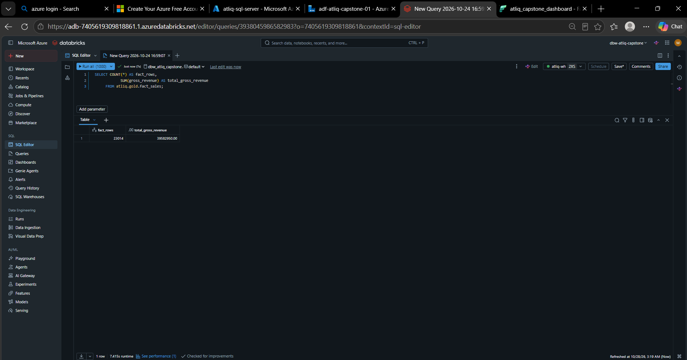
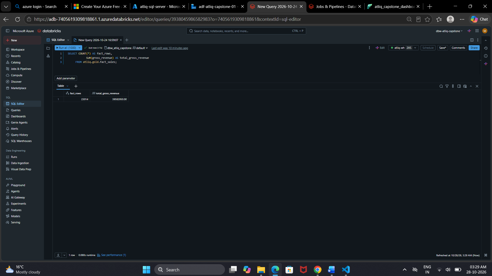
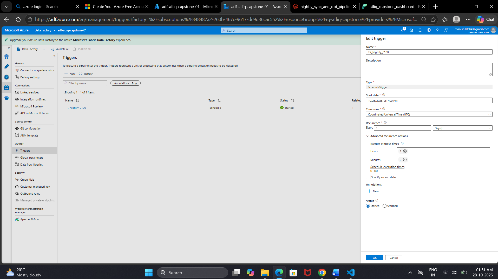
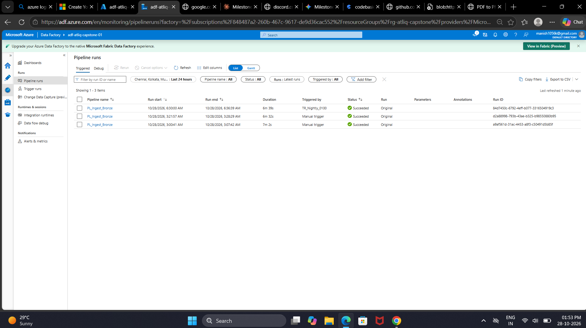
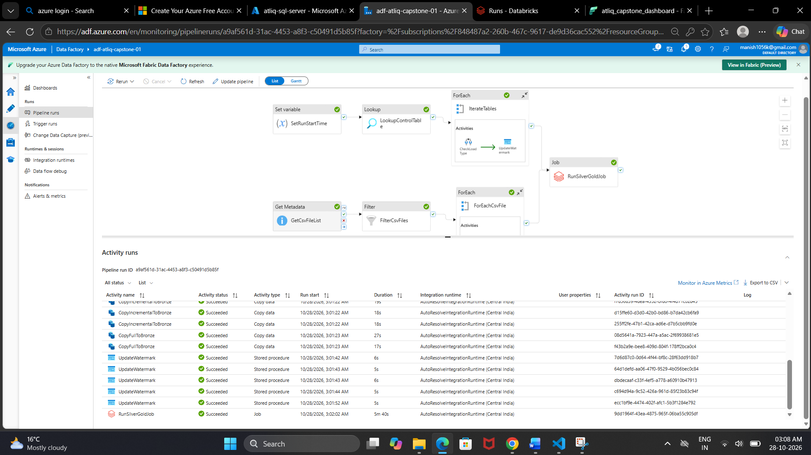
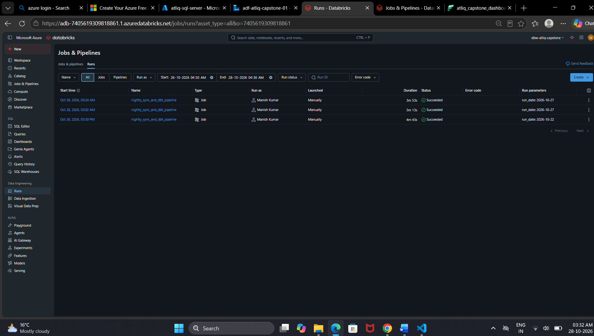
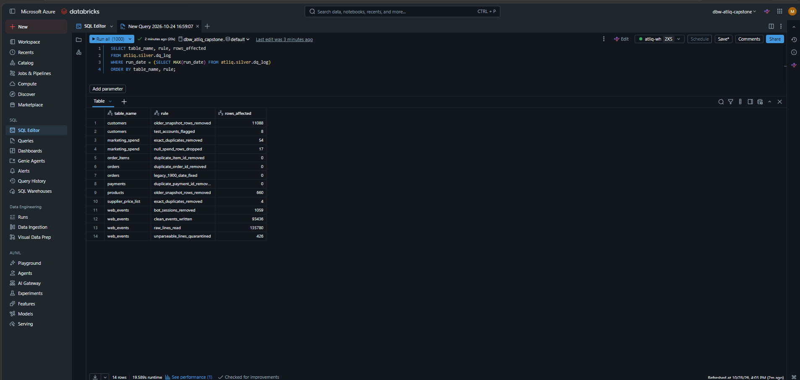
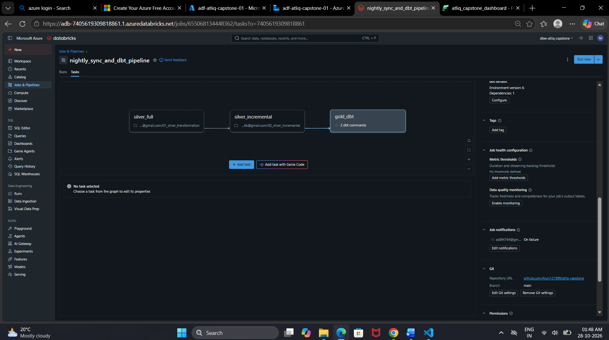
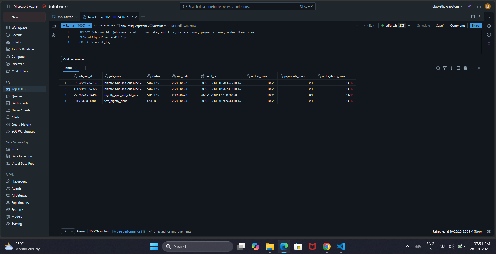
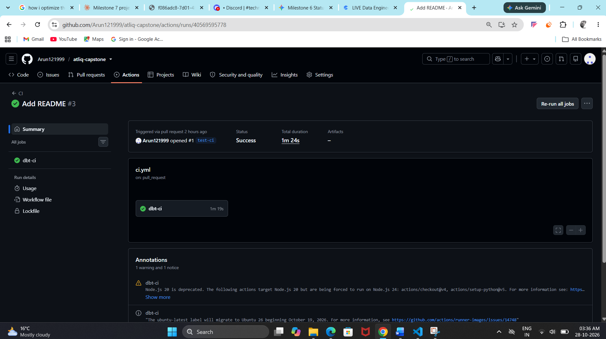

# AtliQ Commerce: Nightly Sales Pipeline

This repo holds the capstone pipeline for AtliQ Commerce. Orders, payments and customers sit in an Azure SQL database. Every night the pipeline copies the new rows into the lakehouse, cleans them in Databricks, builds the Gold tables with dbt, and refreshes a Fabric report.

No secrets are stored here. Tokens and passwords live in environment variables, GitHub secrets and the ADF linked service. `.env.example` shows which variables are needed.

## Architecture

```
Azure SQL (OLTP)
      |  ADF: Lookup on control table, copy only rows newer than the watermark
      v
ADLS Bronze (raw files)
      |  Databricks job: nightly_sync_and_dbt_pipeline
      v
atliq.silver   (cleaned, deduplicated, bad rows quarantined, dq_log)
      |  dbt (atliq_gold)
      v
atliq.gold  ->  Fabric lakehouse lh_atliq_gold  ->  report atliq_capstone_dashboard
```

The ADF pipeline is `PL_Ingest_Bronze`. It sets a run start time, reads the control table, and loops over the tables. Each table is copied to Bronze either in full or incrementally, and then its watermark is updated. A separate branch lists and handles the CSV files. When both finish, the pipeline starts the Databricks job.

The Databricks job runs these tasks in order: `silver_full`, `silver_incremental`, `gold_dbt`. After that, `audit_log_success` runs if everything passed and `audit_log_failed` runs if anything failed.

### Why OLTP and OLAP are split

The SQL database is built for the app: lots of small inserts and updates. Running big aggregations on it would slow down order taking, and the table shapes are wrong for reporting anyway. So reporting reads from a separate copy in the lakehouse, where the data is reshaped into Gold tables and the heavy queries cost the app nothing.

### Control table and watermarks

The `etl_control_table` has one row per source table with the last watermark that was loaded. Each night ADF reads the control table and checks the load type of each table. Full-load tables are copied in full. Incremental tables copy only the rows newer than the watermark, and the watermark moves forward once the copy succeeds. If a run fails halfway, the watermark has not moved, so the next run picks up the same rows again.

### A night with no new data

On a night when no new data arrives in the OLTP database, the ADF Lookup activity returns zero new rows, the Copy activity writes no files, the watermark remains unchanged, and the job still runs and finishes green. The Databricks Silver layer safely handles the empty batch without failing, and the audit log records a successful run with zero rows processed.

### Idempotency

Running the same load twice must not change the result. To check it, I counted `atliq.gold.fact_sales`, ran the pipeline again, and counted again. Nothing changed: 23,014 rows and a gross revenue of 39,582,950.00 both times.

Before the rerun:



After the rerun:



## Repo layout

| Folder | What is in it |
|---|---|
| `sql/` | OLTP schema and starter data scripts (01 to 07), plus `daily_order_simulator.py` which keeps adding orders |
| `adf/` | Exported pipeline and the nightly trigger, `TR_Nightly.json` |
| `notebooks/` | `01_silver_transformation`, `02_silver_incremental`, `03_audit_log` |
| `atliq_gold/` | dbt project (staging and Gold models, tests) |
| `.github/workflows/ci.yml` | CI: runs `dbt build --target ci` on pull requests and pushes to main |
| `screenshots/` | Evidence screenshots used in this README |

Linked services are not exported on purpose, since they can carry credentials.

## How to run it

**Locally (dbt)**

1. Copy `.env.example` to `.env` and fill in the Databricks host, HTTP path and token.
2. From `atliq_gold/`, run `dbt debug` to check the connection.
3. Run `dbt build --target dev` (schema `gold`). The `ci` target writes to schema `ci`.

**In Databricks**

Open the job `nightly_sync_and_dbt_pipeline` and click Run now. It takes one parameter, `run_date`, for example `2026-10-28`.

**In ADF**

Run the pipeline with Trigger now, or let the trigger do it.

### Schedule

The trigger `TR_Nightly_0100` fires at 01:00 UTC, which is 06:30 AM IST. The exported definition is `adf/TR_Nightly.json`.

The trigger: daily, UTC, hour 1, minute 0.



The scheduled run at 06:30 AM IST on 28 Oct, started by the trigger and finished green in 6m 39s.



Inside a run: every copy and watermark update succeeded, then `RunSilverGoldJob` started the Databricks job.



The Databricks job runs from the same night, all succeeded.



### Retry and timeout settings

The first scheduled run failed because the Azure SQL database was paused and took too long to wake up. The fix:

- Retries added on the Lookup and SQL activities in the pipeline
- Connect timeout of 120 seconds and retry count of 3 on the `LS_AzureSqlDatabase` linked service

After that the scheduled run went green.

## Data quality

The Silver notebook logs every rule it checks to `atliq.silver.dq_log`. There are 14 rules. Rows that fail a rule are quarantined, not dropped silently. For example, 426 clickstream lines were quarantined.

Counts from the latest run:

| Table | Rule | Rows affected |
|---|---|---|
| customers | older_snapshot_rows_removed | 11,088 |
| customers | test_accounts_flagged | 8 |
| marketing_spend | exact_duplicates_removed | 54 |
| marketing_spend | null_spend_rows_dropped | 17 |
| order_items | duplicate_item_id_removed | 0 |
| orders | duplicate_order_id_removed | 0 |
| orders | legacy_1900_date_fixed | 0 |
| payments | duplicate_payment_id_removed | 0 |
| products | older_snapshot_rows_removed | 660 |
| supplier_price_list | exact_duplicates_removed | 4 |
| web_events | bot_sessions_removed | 1,059 |
| web_events | clean_events_written | 93,436 |
| web_events | raw_lines_read | 135,780 |
| web_events | unparseable_lines_quarantined | 426 |

Rules showing 0 found nothing to fix in this run.



Two entries need a note. The "older snapshot rows removed" counts for customers (11,088) and products (660) are earlier Bronze snapshots of the same records. They are not bad data. Each load brings a full snapshot, and Silver keeps only the latest one.

dbt tests: 15 on staging and 6 on Gold, all passing in CI.

## Failure alert

The Databricks job `nightly_sync_and_dbt_pipeline` sends an email when a run fails.



## Audit log

Each run of the job writes one row to `atliq.silver.audit_log` with the job run id, job name, status, run date, timestamp and the row counts for orders, payments and order items. A row is written only for the branch that ran: SUCCESS when all tasks pass, FAILED when any task fails.

To see a real FAILED row without touching the production job, I cloned it as `test_nightly_clone`, broke the `gold_dbt` task on purpose, and ran it. `audit_log_failed` fired and wrote the row, then I deleted the clone. 


## Dashboard

The Fabric report `atliq_capstone_dashboard` sits on the model `atliq_gold_model`. 


Revenue definition: Gross Revenue excludes cancelled orders. Returned orders are shown separately as Returned Revenue. Net Revenue is Gross Revenue minus Returned Revenue.

### 28.04M vs 27.85M

The minor variance between the project guide's static baseline figure ($28.04M) and the live dashboard Net Revenue ($27,849,717) occurs because the daily transaction simulator continues to generate new orders and returns past the initial 31 August 2026 checkpoint, whereas the guide's reference figure strictly bounds the seed dataset.

### Why today's totals are higher than the 31 Aug checkpoints

The checkpoints from 31 Aug were orders 9,961, payments 8,183 and order items 22,959. Today they are 10,020, 8,341 and 23,210. The difference is because the simulator keeps adding orders after the checkpoint date, not because anything is off in the pipeline.

## CI

On every pull request and push to main, GitHub Actions runs `dbt build --target ci` against the `ci` schema. The workflow needs three repo secrets: `DATABRICKS_HOST`, `DATABRICKS_HTTP_PATH` and `DATABRICKS_TOKEN`. 

