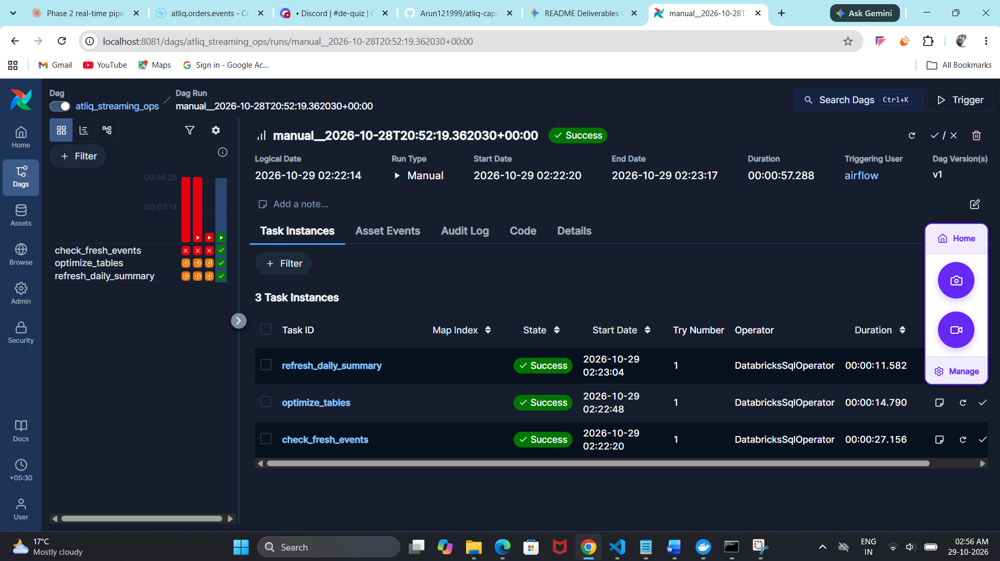
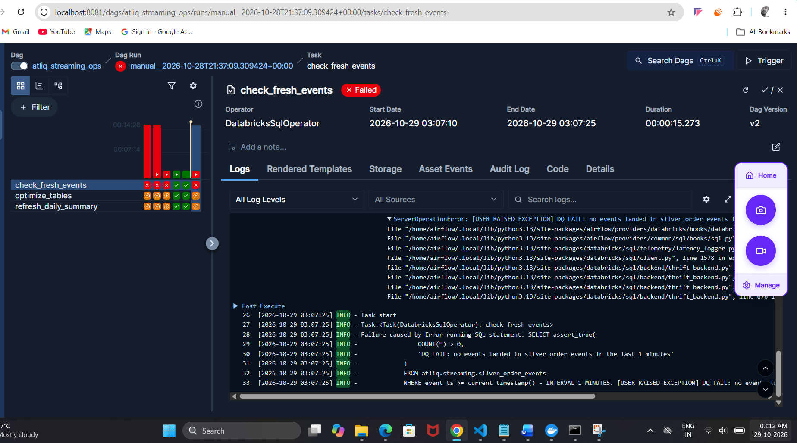

# AtliQ Commerce Phase 2: Real-Time Lane

A real-time lane for AtliQ order events. A Python producer sends events to Kafka on Confluent Cloud. Databricks Structured Streaming builds Bronze, Silver and Gold Delta tables from the topic. An Airflow DAG runs scheduled data-quality and maintenance tasks around the stream.

## Architecture

```
Producer (Python) -> Kafka topic atliq.orders.events (Confluent Cloud)
    -> Bronze (raw JSON + Kafka metadata)
    -> Silver (explicit schema, NULL filter, 10-minute watermark, dedupe)
    -> Gold (gold_revenue_5min: 5-minute windows, payment_received only)

Airflow DAG (hourly): check_fresh_events -> optimize_tables -> refresh_daily_summary
```

## Folder structure

```
phase2_streaming/
  producer/
    order_event_producer.py   Kafka producer (key = order_id, value = JSON)
    .env.example              template for Confluent credentials
  databricks/
    phase2_streaming_bronze_silver.ipynb   Bronze, Silver and Gold streams
  airflow/
    dags/atliq_streaming_ops.py            DQ gate, OPTIMIZE, daily rollup
  screenshots/
    green_run.png             all three tasks succeed
    dq_fail.png               check_fresh_events fails with DQ FAIL
  requirements.txt
  .gitignore
  README.md
```

## How to run

### 1. Confluent Cloud
1. Create a cluster and a topic named `atliq.orders.events`.
2. Create a cluster API key and secret.

### 2. Producer
1. Copy `producer/.env.example` to `producer/.env` and fill in the bootstrap server, API key and API secret.
2. Install and run:
```
pip install -r requirements.txt
python order_event_producer.py --rate 2 --duration 300
```
Add `--clean` to send only clean events while debugging.

### 3. Databricks
1. Save the Confluent credentials in the secret scope `atliq` as `kafka_api_key` and `kafka_api_secret`. The notebook reads them with `dbutils.secrets.get`, so no credentials are stored in the code.
2. Import `databricks/phase2_streaming_bronze_silver.ipynb` and run the cells in order: setup, Bronze, Silver, Gold.
3. All streams use `trigger(availableNow=True)`. While the producer runs, re-run the stream cells to process new events.
4. Each stream has its own checkpoint in the Unity Catalog Volume `atliq.streaming.checkpoints` (`bronze`, `silver`, `gold_5min`).

### 4. Airflow
1. Start Airflow in Docker (UI at `http://localhost:8081`) with the Databricks provider installed.
2. Create the connection `databricks_default` (type Databricks, workspace host, personal access token).
3. Set `SQL_WAREHOUSE_HTTP_PATH` in the DAG file to your SQL warehouse path.
4. Unpause `atliq_streaming_ops` to run it. Pause it again when finished, because each run wakes the SQL warehouse.

## Results

| Table | Rows |
|---|---|
| Bronze | 1948 |
| Silver | 1888 |

Silver dropped 60 records: 42 replayed duplicates, 18 broken records and 0 events later than the watermark.

Gold example window: 16:35 to 16:40, 22 paid orders, revenue 63506.

## Screenshots

Green run, all three tasks succeed:



Data-quality failure, `check_fresh_events` fails while the producer is stopped:



## Security

- No credentials are committed. `.env`, `airflow.cfg`, `.last_order_id` and `logs/` are in `.gitignore`.
- Databricks credentials come from the secret scope `atliq`.
- Only `.env.example` is committed.

## Cost cleanup

Stop all Databricks streams and the SQL warehouse, keep the DAG paused, and delete the Confluent cluster when the work is finished.